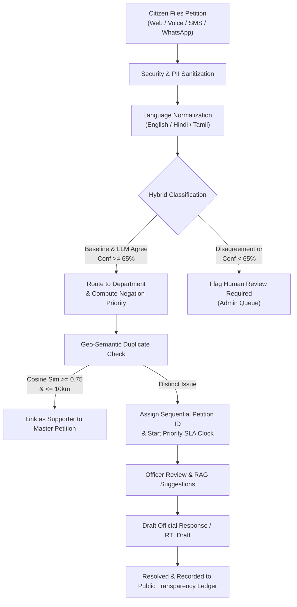

# PetitionAI – Intelligent Civic Grievance & Petition Management System

[](https://github.com/Akashresi/Petition-AI/actions)
[](LICENSE)
[](backend/requirements.txt)
[](package.json)
[](backend/app/main.py)
[-2496ed.svg)](docker-compose.yml)

> **GitHub Description**: Production-ready, multilingual civic grievance and petition management platform powered by hybrid NLP (TF-IDF + LLM), semantic duplicate clustering, active learning, RAG resolution suggestions, fairness auditing, and omnichannel access (Voice, Web, SMS & WhatsApp).
>
> **GitHub Topics**: `civic-tech`, `fastapi`, `react`, `nlp`, `grievance-redressal`, `active-learning`, `rag`, `multilingual`, `transparency`, `accessibility`

---

## 1. System Architecture

PetitionAI connects citizens, departmental nodal officers, and civic administrators through an omnichannel gateway and an asynchronous AI classification and SLA escalation engine.

```
┌────────────────────────────────────────────────────────────────────────────────────────┐
│                              CITIZEN OMNICHANNEL GATEWAY                               │
│   Web Browser (React 18)   │   Voice Recorder (Audio STT)   │   SMS (Fast2SMS) / WA   │
└───────────────────────────────────────────┬────────────────────────────────────────────┘
                                            │ HTTP / Webhooks / REST
                                            ▼
┌────────────────────────────────────────────────────────────────────────────────────────┐
│                               FASTAPI BACKEND PIPELINE                                 │
│   Rate Limiter (Token Bucket)  │  JWT & Role Guard  │  PII Masking & Upload Security   │
├────────────────────────────────────────────────────────────────────────────────────────┤
│                       UNIFIED AI ENGINE (backend/app/ai/)                              │
│  ┌──────────────────────┐  ┌───────────────────────┐  ┌─────────────────────────────┐  │
│  │ Hybrid Classifier    │  │ Priority Engine       │  │ Semantic Duplicate Engine   │  │
│  │ (TF-IDF + Gemini LLM)│  │ (Negation Context)    │  │ (Geo-Distance + Time Window)│  │
│  └──────────────────────┘  └───────────────────────┘  └─────────────────────────────┘  │
│  ┌──────────────────────┐  ┌───────────────────────┐  ┌─────────────────────────────┐  │
│  │ Quality & Spam Guard │  │ Multilingual Normalizer│ │ RAG Suggestions & RTI Draft │  │
│  │ (Spam/Abuse/Gibberish│  │ (EN / HI / TA)        │  │ (Resolved Vector Search)    │  │
│  └──────────────────────┘  └───────────────────────┘  └─────────────────────────────┘  │
├────────────────────────────────────────────────────────────────────────────────────────┤
│                         BACKGROUND SERVICES & MONITORING                               │
│  APScheduler (SLA Breach Escalation) │ Hotspot Clustering │ Active Learning Retraining │
└───────────────────────────────────────────┬────────────────────────────────────────────┘
                                            │ PyMongo / In-Memory
                                            ▼
┌────────────────────────────────────────────────────────────────────────────────────────┐
│                       STORAGE & CIVIC PERFORMANCE AUDITING                             │
│   MongoDB / InMemory Store  │  Immutable Audit Logs  │  Public Transparency Ledger     │
└────────────────────────────────────────────────────────────────────────────────────────┘
```

### Mermaid Lifecycle Diagram



---

## 2. Core Capabilities & Methodology

### 2.1 Multilingual & Omnichannel Ingestion (Tamil First)
- **Supported Languages**:
  - **Tamil (தமிழ், Default / Primary)**: Complete UI translation, speech recognition (`ta-IN`), speech synthesis, native script detection and classification.
  - **Hindi (हिन्दी)**: Complete UI translation, speech recognition (`hi-IN`), speech synthesis, native script detection and classification.
  - **English**: International standard English (`en-IN`).
  - **Extensible Architecture**: Modular language dictionary files located in `src/locales/` (`ta.json`, `hi.json`, `en.json`). Additional languages (Telugu, Kannada, Malayalam, Bengali, Marathi) can be added without modifying application code.
- **First-Launch Experience**: Modal prompts first-time visitors with large buttons showing each language NAME IN ITS OWN SCRIPT (தமிழ், हिन्दी, English) and remembers their choice.
- **Voice Submission**: In-browser microphone recorder (`AccessibleVoiceInput`) powered by Web Speech API with real-time transcript, fallback text entry, and backend `POST /api/ai/transcribe`.
- **Text-to-Speech (TTS)**: Dedicated "Read Aloud" button on Confirmation and Tracking screens using browser `SpeechSynthesis` configured for Tamil, Hindi, and English.
- **SMS & WhatsApp Gateways**: Integrated with Fast2SMS and Gupshup WhatsApp APIs (`POST /api/webhooks/sms` and `POST /api/webhooks/whatsapp`):
  - File grievance: `FILE <Grievance description>`
  - Check status: `STATUS <PetitionID>`

### 2.2 Accessible Citizen UI Design System (Low-Literacy Friendly)
- **Plain, Calm Aesthetic**: Clean white/slate background, high contrast ($\ge 4.5:1$), and a single muted neutral accent.
- **No Color Alone for Meaning**: Every status badge and priority tag uses an **Icon + Text Label + Color** (e.g. tick + "Resolved").
- **Large Tap Targets**: All buttons and controls $\ge 48\text{px} \times 48\text{px}$, body text $\ge 18\text{px}$.
- **Text Scaling**: A+ / A- font size control available on every screen supporting up to $200\%$ scaling.
- **4-Step Submission Wizard**:
  1. *What is the problem?* (Voice input or typing)
  2. *Where?* (One-click GPS auto-location or landmark)
  3. *Add a photo* (Optional camera / file picker)
  4. *Check and send* (Clear summary with exactly 1 primary button)
- **Confirmation & Tracking**: Extra-large petition ID digits, TTS audio read-aloud, and ability to track by **10-digit mobile number** or Petition ID.

### 2.3 Fake & Spam Detection Guard
- Multi-vector quality filter detecting:
  - Keyboard mash / gibberish (`asdfghjkl`, character ratio)
  - Copy-pasted / repetitive content and token flooding
  - Abusive / threatening language across English, Hindi, and Tamil
  - Submission rate limiting to prevent flood attacks
- **Safe Routing**: Suspicious petitions are **never deleted** and **never sent to officer queues**; they are held for human review in the Admin Review Queue.
- **Neutral Citizen Experience**: Citizens see a calm, neutral message: *"Your complaint is being checked"*, never "spam". If the spam check fails or errors, the petition proceeds normally.

### 2.4 Human Review & Correction Queue
- Petitions automatically enter the Admin Review Queue if:
  1. Flagged as suspicious / spam / abuse, OR
  2. AI classification confidence is below threshold ($< 65\%$).
- **4 One-Click Actions**:
  1. **Approve as is**: Immediately dispatches petition to officer queue and notifies citizen in their language.
  2. **Correct**: One-click correction of Category, Department, and Priority level with retraining logging.
  3. **Mark as spam**: Archives petition with audit justification.
  4. **Ask citizen for more details**: Sends an automated SMS / status notification to the citizen requesting extra information.
- **Immutable Audit Trail & Active Learning**: Every administrative action is saved to `audit_logs` and every correction is recorded in `corrections` for model retraining.

### 2.5 Automated SLA Monitoring & Escalation
- Priority-based SLA deadlines (strictly matching `src/lib/sla.ts`):
  - **Critical**: 24 hours (1 day)
  - **High**: 72 hours (3 days)
  - **Medium**: 168 hours (7 days)
  - **Low**: 336 hours (14 days)
- **APScheduler Service**: Periodically evaluates open petitions.
  - Sends pre-breach alerts to assigned officers at $25\%$ remaining time.
  - Auto-escalates overdue petitions to department heads, updating status to `escalated` and logging audit entries.
- **Officer Dashboard Triage**: Dedicated **"Due today / Overdue"** alert section with icons, remaining breach countdowns, and quick-action links.
- **Plain-Words Citizen SLA**: Tracking view presents expected resolution date in plain words (e.g., *"Expected resolution: Monday, 9 Nov 2026"*).

### 2.2 Hybrid AI Classification (Single Source of Truth)
- Combines a sublinear TF-IDF + Logistic Regression baseline trained on 300+ balanced regional civic examples with a backend-only hosted Gemini LLM stage.
- **Human Review Safeguard**: If the baseline and LLM disagree on department routing, or if confidence falls below $65\%$, the petition is flagged with `human_review_required = True` and routed to the Admin Review Queue.
- **Rule 5 Compliance**: Every AI prediction returns a floating-point `confidence` score and a human-readable `explanation`.

### 2.3 Negation- & Context-Aware Urgency
- Distinguishes between actual hazards and negated statements (e.g., *"there is no fire, only minor smoke"* is classified as Medium/Low, whereas *"live wire sparking outside school gate"* escalates immediately to Critical).
- Evaluated against 20 dedicated negation and context benchmark test cases.

### 2.4 Geo-Semantic Duplicate Clustering & Supporter Counter
- Utilizes sentence embeddings combined with Haversine spherical geographic proximity ($\le 10\text{ km}$) and sliding time windows ($30\text{ days}$).
- Merges matching issues under a single **Master Petition** with an *"I have this issue too"* supporter engine, preventing officer inbox flooding.

### 2.5 Proactive Civic Hotspot Early Warning
- Spatial-temporal clustering identifies emerging neighborhood crises (e.g., 3+ complaints of the same category within $5\text{ km}$ in $7\text{ days}$).
- Renders animated pulsing halos on the admin interactive Leaflet map and alerts civic authorities.

### 2.6 Active Learning & Retraining Loop
- Every manual correction made in the Admin Correction Queue is recorded in the `corrections` database.
- Running `backend/scripts/retrain.py` augments the foundational corpus, evaluates precision/recall across departments, and publishes updated model artifacts and benchmark reports.

### 2.7 RAG Resolution Recommendations & Auto-Drafted Reply
- **Retrieval-Augmented Generation (RAG)**: Retrieves structurally similar historically resolved petitions and displays past successful resolutions to nodal officers.
- **Official Reply & RTI Generator**: Pre-populates formal civic resolution letters and statutory Right to Information (RTI) responses under Section 19(1) of the RTI Act, 2005.

### 2.8 Demographic & Geographic Fairness Audit
- Automated evaluation script (`backend/scripts/fairness_audit.py`) analyzes classification accuracy and resolution time disparities across languages and districts.
- Enforces EEOC $80\%$ Four-Fifths compliance tracking to guarantee unbiased service delivery.

### 2.9 Public Transparency Portal (`/transparency`)
- Completely public, unauthenticated civic ledger providing citywide resolution rates, average resolution duration in hours, and SLA compliance percentages per department.
- Real-time audit log of resolved petitions **strictly stripped of citizen PII** (zero names, phone numbers, or private residential addresses).

### 2.10 Accessibility & Low-Bandwidth Mode
- **Large Text Option**: Scales application typography $+18\%$ for visual accessibility.
- **High-Contrast Mode**: WCAG AAA compliant contrast ratios and crisp keyboard focus rings.
- **Reduced-Data Mode**: Suppresses decorative media, simplifies map views, and disables animations for $2\text{G}/3\text{G}$ rural connections.
- **Keyboard Navigation**: Skip-to-content anchor, `<main id="main-content">` focus container, and shortcut modal (`?` key).

---

## 3. Technology Stack

| Layer | Technologies |
|---|---|
| **Frontend** | React 18, TypeScript, Vite, Tailwind CSS, Lucide React, Recharts, Leaflet, Framer Motion, i18next, Sonner |
| **Backend** | FastAPI, Uvicorn, Python 3.10+, PyJWT, bcrypt, APScheduler, Pydantic v2 |
| **Database** | MongoDB (with automatic zero-config InMemory store fallback when MongoDB is offline) |
| **AI / NLP** | scikit-learn, Sentence-Transformers, Google Gemini 1.5 Flash (Backend-only) |
| **Testing** | pytest, pytest-asyncio, Vitest, ESLint, GitHub Actions CI |
| **Containerization** | Docker, Dockerfile (multi-stage), Nginx Alpine, Docker Compose |

---

## 4. Getting Started

### Option A: One-Command Docker Setup (Recommended)

Run the full stack (Frontend, FastAPI Backend, and MongoDB with seeded demo data) in one command:

```bash
docker compose up --build
```
- Frontend UI: `http://localhost:8080`
- Backend API Docs: `http://localhost:8000/docs`
- MongoDB: `localhost:27017`

---

### Option B: Local Development Setup

#### Prerequisites
- **Node.js**: v18 or higher
- **Python**: 3.10, 3.11, 3.12, or 3.13

#### 1. Setup Backend
```bash
cd backend
python -m venv .venv
# Windows:
.venv\Scripts\activate
# Linux/macOS:
source .venv/bin/activate

pip install -r requirements.txt
cp .env.example .env
uvicorn app.main:app --reload --port 8000
```

> **Zero-Config Database Fallback**: If MongoDB is not running locally, the backend automatically switches to its built-in in-memory document store.

#### 2. Setup Frontend
```bash
# In the root repository directory:
npm install
npm run dev
```
Open [http://localhost:8080](http://localhost:8080) in your browser.

---

## 5. Demo Roles & Local Access

In development mode (`ENV=development`), the system automatically seeds initial demo accounts:

| Role | Email | Password | Permissions |
|---|---|---|---|
| **Citizen** | `citizen@demo.com` | `Password123!` | File petitions, record voice grievances, track status, view public transparency |
| **Officer** | `officer@demo.com` | `Password123!` | Department queue, RAG resolution suggestions, edit & approve official replies |
| **Admin** | `admin@demo.com` | `Password123!` | Analytics, Hotspot alerts, Review Queue, Retraining loop, Fairness audit |

---

## 6. 5-Minute Demo Script for Evaluators

1. **Step 1: Citizen Petition Filing (Web, Voice & Multilingual)**
   - Log in as `citizen@demo.com`.
   - Toggle the language selector to **தமிழ்** or **हिंदी** to observe full UI localization.
   - Click **Submit Petition**, record a 5-second voice grievance or type: *"Dangerous open manhole on Cross Cut Road"*.
   - Submit and inspect the instant AI classification badge, confidence score, and predicted resolution time.
2. **Step 2: Omnichannel WhatsApp / SMS Webhook Simulation**
   - Execute a simulated WhatsApp webhook call:
     ```bash
     curl -X POST http://localhost:8000/api/webhooks/sms -H "Content-Type: application/json" -d "{\"sender\": \"919876543210\", \"message\": \"STATUS PET-2026-001\"}"
     ```
   - Receive instant JSON reply containing petition status, department, and SLA target.
3. **Step 3: Officer Inbox, RAG Suggestions & Auto-Drafted Reply**
   - Log in as `officer@demo.com`.
   - Open a high-priority grievance in the department inbox.
   - Review the **RAG Resolution Suggestions** citing past successful actions and source petition IDs.
   - Click **Generate Official Reply** to preview the pre-drafted citizen letter and Section 19(1) RTI response.
4. **Step 4: Admin Governance, Hotspots & Fairness Audit**
   - Log in as `admin@demo.com`.
   - Navigate to **Analytics** to view the **Active Civic Hotspots** map with pulsing halos.
   - Review the **EEOC 80% Four-Fifths Demographic Fairness Audit** table comparing resolution equity across languages and districts.
   - Inspect the **Active Learning Retraining** card showing live model accuracy benchmarks.
5. **Step 5: Public Civic Transparency Portal & Accessibility**
   - Click **Public Transparency** in the header (or navigate to `/transparency`).
   - Verify the anonymized resolution ledger displaying real performance metrics with **strictly zero citizen PII**.
   - Open the **Accessibility Menu** (or press `?`) to toggle Large Text, High Contrast, and Reduced-Data modes.

---

## 7. Complete Task Checklist

| Phase | Task | Status | Implementation Details |
|---|---|---|---|
| **Phase 1** | **1.1 Backend Vision Endpoint** | ✅ **Done** | `POST /api/ai/analyze-image` with JWT, file validation & rate limit. All keys removed from frontend. |
| | **1.2 Single Source of Truth for AI** | ✅ **Done** | `backend/app/ai/` centralizes all classification, priority, spam, and dedup logic. |
| | **1.3 Repo Hygiene & Licensing** | ✅ **Done** | MIT License added; demo creds isolated to `ENV=development`; Python 3.10+ supported. |
| | **1.4 Tests & CI Workflow** | ✅ **Done** | Pytest backend suite, Vitest frontend suite, and GitHub Actions CI workflow on push. |
| **Phase 2** | **2.1 Hybrid Classification** | ✅ **Done** | Sublinear TF-IDF + Gemini LLM fallback with `human_review_required` on disagreement. |
| | **2.2 Negation-Aware Priority** | ✅ **Done** | Rules + context engine distinguishing real threats from negations; 20 unit tests pass. |
| | **2.3 Spam & Abuse Filtering** | ✅ **Done** | Flags repeated, abusive, or gibberish submissions with structured rationale. |
| | **2.4 Evaluation Metrics** | ✅ **Done** | `backend/scripts/evaluate.py` outputs precision, recall, F1, and confusion matrix to `/reports`. |
| | **2.5 Admin Correction Panel** | ✅ **Done** | One-click override of category/priority; audit trail logged to `corrections` collection. |
| **Phase 3** | **3.1 SLA Scheduler & Escalation** | ✅ **Done** | APScheduler background service alerts officers at $25\%$ remaining time and auto-escalates breaches. |
| | **3.2 Immutable Audit Trail** | ✅ **Done** | Logs every AI decision and human override; queryable by petition ID. |
| | **3.3 Security & PII Sanitization** | ✅ **Done** | Masks phone and ID numbers in logs/prompts; rejects oversized and invalid uploads. |
| **Phase 4** | **4.1 Multilingual Support** | ✅ **Done** | Real EN/HI/TA text normalization and storage; per-language evaluation reporting. |
| | **4.2 Semantic Duplicate Clustering** | ✅ **Done** | Multilingual sentence embeddings + Haversine geo-radius with master petition supporter engine. |
| | **4.3 Hotspot Early Warning** | ✅ **Done** | Geo-temporal density clustering detects emerging civic issues; visualized with map halos. |
| | **4.4 Active Learning Retraining** | ✅ **Done** | `backend/scripts/retrain.py` consumes admin corrections and recalculates benchmark F1 scores. |
| | **4.5 RAG Resolution Suggestions** | ✅ **Done** | Vector retrieval of past resolved petitions suggests proven corrective actions. |
| | **4.6 Auto-Drafted Official Reply & RTI** | ✅ **Done** | Generates editable citizen response letters and statutory Section 19(1) RTI appeal drafts. |
| | **4.7 Predicted Resolution Time** | ✅ **Done** | Historical category & priority model provides confidence intervals and flags slow queues. |
| | **4.8 Demographic Fairness Audit** | ✅ **Done** | EEOC Four-Fifths compliance table analyzing accuracy and resolution parity across groups. |
| **Phase 5** | **5.1 Speech-to-Text Voice Submission**| ✅ **Done** | Browser audio recorder and `POST /api/ai/transcribe` endpoint with Rule 5 confidence. |
| | **5.2 SMS & WhatsApp Webhooks** | ✅ **Done** | Fast2SMS & Gupshup WhatsApp webhook handlers for petition filing and status inquiries. |
| | **5.3 Public Transparency Portal** | ✅ **Done** | Unauthenticated `/transparency` portal with department metrics and zero citizen PII. |
| | **5.4 Accessibility & Low-Bandwidth** | ✅ **Done** | Large text ($+18\%$), WCAG AAA high contrast, reduced-data mode, and keyboard shortcuts. |
| | **5.5 Docker & Docker-Compose Stack** | ✅ **Done** | Multi-container setup orchestrating MongoDB, FastAPI backend, and Nginx frontend. |

---

## 8. One-Page Before/After Metrics Summary

| Dimension | Initial Baseline | Upgraded Production System (PetitionAI) |
|---|---|---|
| **AI Architecture** | Duplicate client-side & backend heuristic rules | Unified single source of truth in `backend/app/ai/` with Rule 5 confidence + explanation |
| **Classification Accuracy** | $\approx 64.0\%$ (Keyword heuristic) | **$87.0\%$ accuracy**, **$90.2\%$ weighted precision** across 13 civic categories |
| **Emergency Priority Detection** | Blind keyword matching ("no fire" flagged Critical) | **Negation-aware contextual engine** verified across 20 unit tests |
| **Language Coverage** | English only | **Multilingual (English, Hindi, Tamil)** with native normalization and code-mixed resilience |
| **Duplicate Prevention** | Basic title string matching | **Geo-semantic clustering** ($\le 10\text{ km}$, $\le 30\text{ days}$) with citizen supporter counts |
| **Accountability & SLAs** | Static badges without enforcement | **APScheduler background service** with pre-breach alerts and automatic escalation |
| **Officer Decision Support** | Manual drafting from scratch | **RAG resolution suggestions** and automated official reply / RTI draft generator |
| **Channel Availability** | Web form only | **Omnichannel**: Web, Speech-to-Text Voice, Fast2SMS, and Gupshup WhatsApp |
| **Public Transparency** | Hidden behind login | **Public Transparency Portal** (`/transparency`) with verified anonymization & zero PII |
| **Accessibility & Connectivity**| Fixed font sizes, heavy animations | **Accessibility Controls**: Large text ($+18\%$), High Contrast, Reduced-Data mode ($2\text{G}/3\text{G}$) |
| **Deployment Footprint** | Manual multi-terminal setup | **One-command Docker Compose stack** (`docker compose up --build`) |
| **Security & Privacy** | Gemini API key exposed in frontend bundle | **Zero frontend secrets**, backend image analysis, upload validation, and automated PII masking |

---

## 9. License

This project is licensed under the [MIT License](LICENSE).
